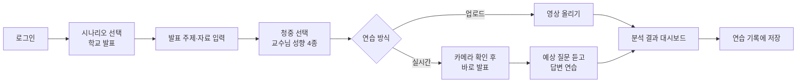
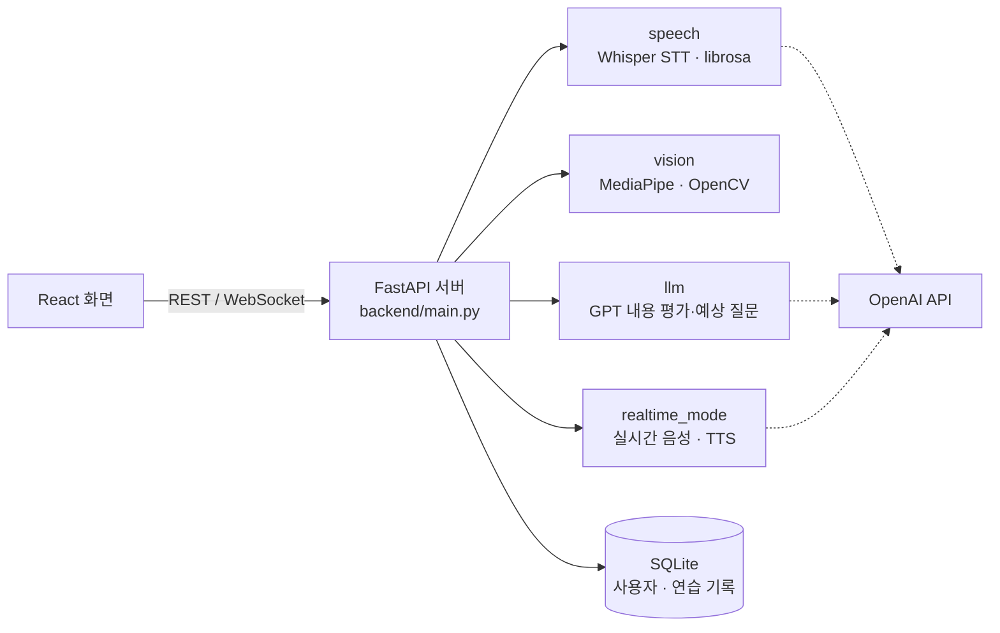

# AICO — AI 발표 코칭

> 발표 영상을 올리거나 실시간으로 발표하면, AI가 **내용·목소리·태도**를 분석해 점수와 피드백을 주고
> 교수님 성향별 **예상 질문**까지 던져 주는 발표 연습 서비스입니다.

혼자 발표를 연습하면 무엇이 부족한지 알기 어렵습니다. AICO는 발표 대본, 말하는 속도와 억양, 시선과 표정, 손동작을 함께 보고 "어디를 어떻게 고치면 되는지"를 알려 줍니다.

<br>

## 목차

1. [주요 기능](#1-주요-기능)
2. [사용 흐름](#2-사용-흐름)
3. [분석과 채점 방식](#3-분석과-채점-방식)
4. [시스템 구성](#4-시스템-구성)
5. [기술 스택](#5-기술-스택)
6. [폴더 구조](#6-폴더-구조)
7. [API](#7-api)
8. [실행 방법](#8-실행-방법)
9. [팀원](#9-팀원)

<br>

## 1. 주요 기능

| 기능 | 설명 |
|---|---|
| **두 가지 연습 방식** | 녹화한 발표 영상을 올리는 **업로드 모드**, 카메라 앞에서 바로 발표하는 **실시간 모드** |
| **내용 평가** | Whisper로 바꾼 발표 대본을 GPT가 구성·근거·표현 기준으로 채점하고, 요약·총평·강점·약점·개선점을 정리 |
| **목소리 분석** | 말하는 속도(WPM), 억양의 생동감, "음·어" 같은 습관어 횟수 분석 |
| **태도 분석** | 고개 방향, 표정, 시선, 손동작을 MediaPipe로 분석하고 시간대별 점수 그래프 제공 |
| **청중 설정과 예상 질문** | 멘토형·압박형·비판형·기본형 네 가지 교수님 심사위원 중 골라, 그 성향에 맞는 예상 질문과 출제 의도를 생성 |
| **질문 음성과 답변 연습** | 예상 질문을 TTS로 읽어 주고, 내 답변을 녹음하면 텍스트로 바꿔 줌 |
| **카메라 위치 안내** | 발표 전 카메라에 얼굴이 잘 잡히는지 미리 확인 |
| **연습 기록** | 로그인한 사용자별로 결과와 영상, 연습 횟수를 저장하고 이름 변경·삭제 가능 |

<br>

## 2. 사용 흐름



<br>

## 3. 분석과 채점 방식

영상이 올라오면 **음성 분석과 영상 분석을 동시에** 돌리고(`asyncio.gather`), 음성에서 나온 대본으로 내용 평가를 이어서 합니다.

### 최종 점수

```
최종 점수 = (내용 점수 + 목소리 점수 + 태도 점수) / 3
```

### 세부 점수

| 영역 | 담당 모듈 | 기준 |
|---|---|---|
| **내용** | `llm/` (GPT-4o-mini) | 구성 40% + 근거 40% + 표현 20% |
| **목소리** | `speech/` (Whisper, librosa) | 말하기 속도 40% + 억양 생동감 35% + 습관어 25% |
| **태도** | `vision/` (MediaPipe, OpenCV) | 고개 방향 45% + 표정 25% + 시선 15% + 손동작 15% |

### 내용 평가에서 신경 쓴 점

- **점수 일관성**: 같은 발표에 점수가 들쑥날쑥하지 않도록 JSON 스키마로 응답 형식을 고정하고 `temperature=0`으로 둡니다. 총점은 GPT에게 맡기지 않고, 세부 점수를 0~100으로 보정한 뒤 **서버가 가중치로 직접 계산**합니다.
- **역할 분리**: `summary`(객관적 요약)와 `content_critique`(비평)를 다른 필드로 나눠, 요약에 평가가 섞이지 않게 했습니다.
- **입력 방어**: 대본이 비었거나 너무 짧으면 GPT를 호출하지 않고 안내 응답을 돌려줘, 엉뚱한 피드백과 불필요한 API 비용을 막습니다.
- **습관어 확인**: 습관어 후보를 먼저 찾은 뒤 GPT로 한 번 더 확인해, 문맥상 필요한 말이 습관어로 잘못 세어지지 않게 합니다.

### 교수님 심사위원 4종

| 화면 이름 | 키 | 성향 | 질문 스타일 |
|---|---|---|---|
| 멘토형 | `mentor` | 우호적·전문적 | 발표의 핵심 용어를 짚으며 발전 방향을 묻는 질문 |
| 압박형 | `press` | 엄격·전문적 | 근거가 약한 주장이나 논리의 빈틈을 파고드는 질문 |
| 비판형 | `troll` | 엄격·비전문적 | 곁가지 내용을 오해해 트집 잡는 질문 (맥락을 바로잡는 연습) |
| 기본형 | `basic` | 우호적·비전문적 | 기대 효과, 대상, 앞으로의 계획 같은 기본 질문 |

질문마다 **"이 질문으로 무엇을 확인하려는지"(출제 의도)** 를 함께 보여 줘서, 답변을 어떻게 준비해야 할지 알 수 있습니다.

<br>

## 4. 시스템 구성



<br>

## 5. 기술 스택

| 영역 | 사용 기술 |
|---|---|
| 화면 | React 19, React Router 7, Vite |
| 서버 | Python 3.11, FastAPI, Uvicorn, WebSocket |
| AI | OpenAI GPT-4o-mini(내용 평가·질문 생성), Whisper(음성 → 텍스트), gpt-4o-mini-tts(질문 음성) |
| 음성 분석 | librosa, NumPy, SciPy, ffmpeg |
| 영상 분석 | MediaPipe(Face Mesh, Face Detection, Hands), OpenCV |
| 데이터 | SQLite, SQLAlchemy, Alembic |
| 인증 | JWT(HS256), bcrypt, 로그인 실패 시 잠금 |

<br>

## 6. 폴더 구조

```
AICOproject/
├── frontend/              React 화면
│   └── src/
│       ├── pages/         홈, 로그인, 시나리오, 발표 설정, 청중 선택, 연습 방식,
│       │                  업로드, 실시간, 대시보드, 연습 기록, 마이페이지, 튜토리얼
│       └── components/    공용 컴포넌트, dashboard/ 결과 화면 조각
├── backend/
│   ├── main.py            FastAPI 진입점 (업로드 분석, 기록, 질문 음성 등)
│   └── realtime_mode/     실시간 모드 (WebSocket 음성 수신, 질문 생성, TTS)
├── llm/app/               내용 평가 (프롬프트, 심사위원 페르소나, 채점)
├── speech/                음성 분석 (STT, 속도, 억양, 습관어)
├── vision/                영상 분석 (고개 방향, 표정, 시선, 손동작, 카메라 안내)
├── database/              DB 연결, 모델, 스키마, 로그인(auth.py)
└── alembic/               DB 마이그레이션
```

<br>

## 7. API

| 메서드 | 주소 | 설명 |
|---|---|---|
| POST | `/auth/register` | 회원가입 |
| POST | `/auth/login` | 로그인 (JWT 발급) |
| POST | `/check-camera` | 카메라 화면에 얼굴이 잘 잡히는지 확인 |
| POST | `/upload` | 발표 영상 분석 (음성·영상·내용) 후 기록 저장 |
| GET | `/records` | 내 연습 기록 목록 |
| GET | `/records/{record_id}` | 연습 기록 상세 |
| PATCH | `/records/{record_id}` | 기록 이름 변경 |
| DELETE | `/records/{record_id}` | 기록 삭제 |
| GET | `/result/{file_id}` | 음성 분석 결과 조회 |
| POST | `/api/v1/ai/feedback` | 대본만으로 내용 평가 |
| WS | `/ws/audio` | 실시간 모드 음성 수신 |
| POST | `/realtime/generate-questions` | 실시간 발표 내용으로 예상 질문 생성 |
| POST | `/tts-question` | 예상 질문을 음성으로 변환 |
| POST | `/stt-answer` | 질문에 대한 내 답변을 텍스트로 변환 |

서버를 켠 뒤 `http://127.0.0.1:8000/docs`에서 전체 API를 직접 시험해 볼 수 있습니다.

<br>

## 8. 실행 방법

### 준비

- Python 3.11
- Node.js 20 이상
- [ffmpeg](https://ffmpeg.org/) (영상에서 음성을 뽑을 때 사용)
- OpenAI API 키

### 1) 환경변수

저장소 맨 위에 `.env` 파일을 만듭니다. (`.env`는 Git에 올리지 않습니다.)

```env
OPENAI_API_KEY=sk-...
OPENAI_MODEL=gpt-4o-mini        # 생략하면 gpt-4o-mini
SECRET_KEY=아무도-모르는-긴-문자열  # JWT 서명용
```

### 2) 서버

```bash
cd backend
python -m venv .venv311
source .venv311/bin/activate          # Windows: .venv311\Scripts\activate
pip install -r requirements.txt

alembic -c ../alembic.ini upgrade head   # backend/presentation.db에 표 만들기
uvicorn main:app --reload --port 8000
```

### 3) 화면

```bash
cd frontend
npm install
npm run dev
```

화면은 `frontend/.env.development`의 `VITE_API_URL`(기본 `http://127.0.0.1:8000`)로 서버에 요청합니다.

<br>

## 9. 팀원

**SpeechLab04** · 2026년 1학기 (2026.03 – 06)

| 이름 | GitHub | 담당 |
|---|---|---|
| 박수연 | [@suyeon040610](https://github.com/suyeon040610) | React 프론트엔드 · 분석 대시보드, 멀티모달 분석 파이프라인 통합(비동기 처리), AWS 배포 |
| 고혜민 | [@gohyemin0112](https://github.com/gohyemin0112) | 영상 분석 (고개 방향·표정·시선·손동작) |
| 문지수 | [@jessjessjes](https://github.com/jessjessjes) | 음성 분석 (STT·속도·억양·습관어), 실시간 모드 |
| 김지영 | [@yeong0128](https://github.com/yeong0128) | LLM 기반 발표 평가 엔진 · 페르소나 예상 질문 생성, 연습 기록 DB, JWT 인증 |
